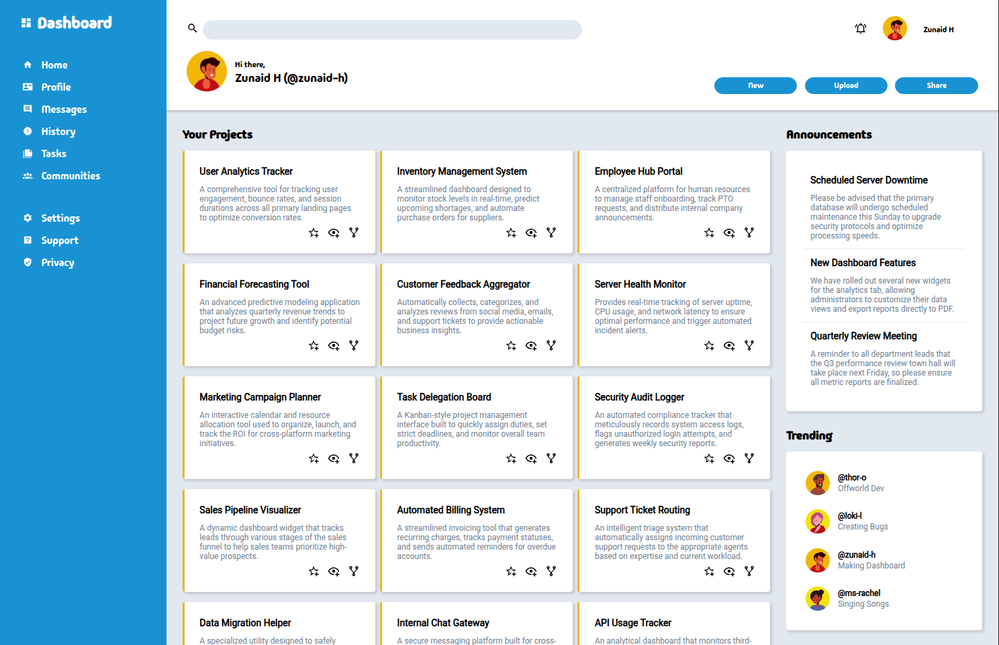

## The Odin Project: Admin Dashboard

### Links

Project link: https://www.theodinproject.com/lessons/node-path-intermediate-html-and-css-admin-dashboard

Live preview: https://zunaid-hassan.github.io/odin-admin-dashboard/

### Description

An admin dashboard built for The Odin Project’s Intermediate HTML & CSS course, with CSS Grid handling the layout. It features a sidebar with branding and navigation, a header with a search bar, user info, and action buttons, and a main content area with project cards, announcements, and trending items, all laid out using nested grid containers.

### Preview

### Credits & Attribution

**Images**

- Profile pictures taken from [Circular](https://www.flaticon.com/packs/people-avatar-9) by [BrazOz](https://www.flaticon.com/authors/braoz), Flaticon

**Icons**

- [Material Design Icons](https://pictogrammers.com/library/mdi/) from Pictogrammers

**Fonts**

- [Madimi One](https://fonts.google.com/specimen/Madimi+One?preview.script=Latn) by Taurai Valerie Mtake, Mirko Velimirović

- [Roboto](https://fonts.google.com/specimen/Roboto) by Christian Robertson, ParaType, Font Bureau
